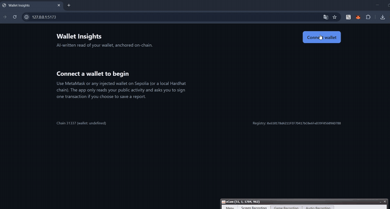

# Wallet Insights

https://github.com/user-attachments/assets/e852e5ce-0fbc-4812-8a7c-d4da6eac1155



An AI-powered Web3 sample app: connect a wallet, get a plain-English read of its on-chain
activity written by Claude, and anchor a hash of that report in a smart contract so it can
be verified later.

```
┌──────────────────────┐   HTTP (JSON)   ┌───────────────────────┐   JSON-RPC / Etherscan
│  dashboard/          │ ──────────────▶ │  ai-service/          │ ─────────────────────▶  Sepolia
│  React + wagmi/viem  │ ◀────────────── │  FastAPI + Claude     │
│  MetaMask (injected) │  report + hash  └───────────────────────┘
│                      │
│   saveInsight(hash)  │   wallet signs tx    ┌───────────────────────┐
│ ─────────────────────┼─────────────────────▶│  contracts/           │  on Sepolia / Hardhat
│   latestInsights()   │   read              │  InsightRegistry.sol  │
└──────────────────────┘                     └───────────────────────┘
```

**Design rule that holds the whole thing together:** the AI service never touches a private
key, and the chain never stores the report text. The service _reads_ the chain and returns
`report_json` + `report_hash` (keccak256 of the canonical JSON). The _wallet_ signs the
`saveInsight(hash)` transaction in the browser. Anyone with the JSON can recompute the hash
and compare it with what's on-chain.

## Folders

| Folder        | Stack                                  | Purpose                                                |
| ------------- | -------------------------------------- | ------------------------------------------------------ |
| `contracts/`  | Solidity 0.8.24, Hardhat, ethers v6    | `InsightRegistry` + tests + deploy script              |
| `ai-service/` | Python 3.11+, FastAPI, Anthropic SDK   | Reads wallet data, asks Claude for a structured report |
| `dashboard/`  | React 18, Vite, TypeScript, wagmi/viem | Wallet connect, overview, AI panel, on-chain history   |
| `shared/`     | JSON                                   | Contract ABI + deployed addresses (written by deploy)  |

## Run it locally (all four parts)

Prereqs: Node 20+, Python 3.11+, MetaMask (or any injected wallet).

### 0. Env

```bash
cp .env.example .env
# Fill in ANTHROPIC_API_KEY (optional — without it a rules-based fallback runs),
# and ETHERSCAN_API_KEY (optional — without it there is no tx history, only balance).
```

### 1. Contracts — test, then run a local chain and deploy

```bash
cd contracts
npm install
npm test                      # 4 passing

# terminal A: local chain with 20 funded accounts
npm run node

# terminal B: deploy to it → writes ../shared/InsightRegistry.json with the address for chain 31337
npm run deploy:local
```

Import one of the printed Hardhat private keys into MetaMask (a throwaway "Hardhat" account)
and add the network `http://127.0.0.1:8545`, chain id `31337`.

### 2. AI service

```bash
cd ai-service
python -m venv .venv && source .venv/bin/activate   # Windows: .venv\Scripts\activate
pip install -r requirements.txt
pytest                                               # 5 passing, no network needed
uvicorn app.main:app --reload --port 8000
# http://localhost:8000/docs for the interactive API
```

Note: `RPC_URL`/`CHAIN_ID` in `.env` decide which chain the service _reads_. For the local
Hardhat chain set `CHAIN_ID=31337` and `RPC_URL=http://127.0.0.1:8545` (Etherscan has no data
for it, so leave `ETHERSCAN_API_KEY` empty). For Sepolia leave the defaults.

### 3. Dashboard

```bash
cd dashboard
npm install
npm run dev          # http://localhost:5173
```

Connect → Overview loads → **Analyze this wallet** → **Save hash on-chain** → it appears under
"Saved on-chain".

### 4. Going to Sepolia

1. Get Sepolia ETH from a faucet into a throwaway account; put its key in `DEPLOYER_PRIVATE_KEY`.
2. `cd contracts && npm run deploy:sepolia` → the Sepolia address is added to `shared/InsightRegistry.json`.
3. Set `CHAIN_ID=11155111` for the AI service, switch MetaMask to Sepolia, done.

## Guided tour — read these in order

1. **`contracts/contracts/InsightRegistry.sol`** (70 lines). One struct, one mapping, one event,
   two custom errors. Note what is _not_ stored: the report. Then read
   **`contracts/test/InsightRegistry.test.js`** — each test is one behaviour; the last one shows
   how custom errors are asserted.
2. **`ai-service/app/schemas.py`** — the contract between every layer. The same shapes appear in
   `dashboard/src/api.ts`. If you change one, change the other.
3. **`ai-service/app/chain.py`** — two raw JSON-RPC calls (balance, nonce) and one Etherscan call.
   No web3 library; seeing the raw calls demystifies what libraries do for you.
4. **`ai-service/app/llm.py`** — the interesting part. `INSIGHT_TOOL` is a JSON schema; Claude is
   forced (`tool_choice`) to "call" it, so the answer is typed data, never free text to parse.
   `analyze_with_rules` is the offline fallback and the thing tests exercise.
5. **`ai-service/app/report.py`** — canonical JSON + keccak256. Why canonical? Key order must not
   change the hash.
6. **`dashboard/src/wagmi.ts`** — chains, connector, transports: the entire wallet setup.
7. **`dashboard/src/components/InsightPanel.tsx`** — `useMutation` for the API call,
   `useWriteContract` for the transaction, `useWaitForTransactionReceipt` to know it mined. That
   trio is most of dApp front-end work.
8. **`contracts/scripts/deploy.js`** — writes the ABI and address to `shared/`, which is how the
   front end learns where the contract lives without hard-coding anything.

## Exercises (in rough order of effort)

1. **Pin the report to IPFS.** Upload `report_json` (web3.storage or Pinata) and pass the CID as
   `uri` in `saveInsight`. Then show a "Verify" button that fetches the URI, hashes it client-side
   with `viem`'s `keccak256`, and compares with the stored hash.
2. **Token balances.** Add ERC-20 balances to the snapshot (Etherscan `tokentx`, or multicall via
   viem) and feed them to the prompt. The AI gets much more interesting with tokens in view.
3. **Approvals scanner.** Parse `approve`/`setApprovalForAll` events and list live allowances; let
   the AI rank which to revoke; add a "Revoke" button that sends `approve(spender, 0)`.
4. **Events over polling.** Subscribe to `InsightSaved` with `useWatchContractEvent` instead of
   invalidating queries after the receipt.
5. **Streaming.** Switch the AI endpoint to stream Claude's output (SSE) and render the summary
   as it arrives.
6. **Tests for the Claude path.** Mock `AsyncAnthropic.messages.create` to return a fake
   `tool_use` block and assert `analyze_with_claude` validates it.
7. **Deploy it.** Dashboard → Firebase Hosting (`npm run build`, serve `dist/`); AI service →
   Cloud Run / Fly.io; contract → Sepolia (already covered).

## Security notes worth saying out loud in an interview

- The service is read-only; the private key stays in the wallet. Never move signing server-side
  for a user-facing app.
- `DEPLOYER_PRIVATE_KEY` is for a throwaway testnet account. The repo ignores `.env`.
- The contract lets any address write to _its own_ list only (`msg.sender`), so there is nothing
  to permission.
- Prompt-injection surface: transaction data (e.g. token names, method names) reaches the LLM.
  The system prompt tells the model to describe, not act, and the model has no tools except the
  typed `report_insight` schema — it cannot do anything with injected text except put words in
  the report.

## What was verified when this scaffold was generated

The Python logic (rules engine, canonical hashing, tool-schema ↔ model parity) was exercised
offline. `npm install`/`pip install` could not run in the generation sandbox (no registry
access), so the Hardhat tests and the Vite build were **not** executed there. Expect to fix
small things on first run (a version pin, a type nit); that's normal and part of the exercise.
If something fails, the error plus the file name is enough for me to fix it with you.
